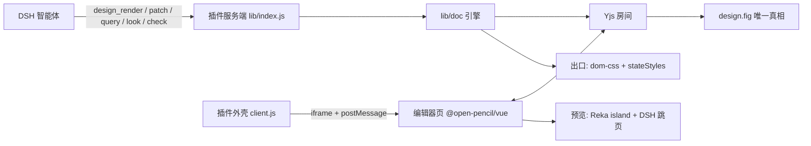

# DSH Design Studio v2

插件是宿主，OpenPencil 是心脏。插件继续负责和智能体联动（工具、胶囊、点选回对话、命令面、历史）。画布和文档交给 Pencil。日常在用的 `~/.dsh/profiles/desktop/node_modules/dsh-design-studio`（1.1.0）全程只读。本仓库用 profile 里的一行 `link:` 切换，不改插件名，避免 `preview_page` 等同名工具冲突。

回滚：把 `"dsh-design-studio"` 改回 `"1.1.0"`，在 profile 目录 `pnpm i`，重启 DSH。`vendor/1.1.0/lib/` 是现装副本的原样快照，只用于 diff。

## 目标架构

- 编辑器页跑在插件自己的预览端口（`serve.js`）里，以 iframe 嵌入外壳。wasm 和字体同源加载，不依赖 DSH 网页端的 CSP。Vue 编辑器和 React 外壳沿用现有 `dshDesign` postMessage 通道。
- 模型工具和画布都作为 Yjs 房间的 peer 写入，只有服务端落盘 `.fig`。`@open-pencil/collab` 没有发布到 npm，从 `Konbir-lab/open-pencil` 构建后放进来。其余引擎依赖钉 npm 上的 `0.17.0`，升级前先跑 contract test。
- 一屏就是文档里的一个顶层 frame。模型直接生成 Design JSX 进文档。旧 HTML 屏用 `html-engine` + `dom-css` 一次性导入。`lib/doc.js`（PDF/PPTX）、`htmlpack.js`、gallery 留到 M5 之后再决定是否退役。
- 控件级交互用 Pencil behaviours，预览时是 Reka UI 实组件。跨屏流程（跳页、返回、页面状态、mock）以 DSH 扩展写进 frame 的 `pluginData`，由预览视图执行。
- 工具面从 OpenPencil MCP 的 46 个工具收成插件自带的 5～6 个粗粒度工具，读写都用 JSX。OpenPencil.app 只作为「在原生 App 里打开同一份 `.fig`」的兜底。

## 里程碑

- [ ] M0 生成面门。Design JSX → `.fig` → PNG@2x，和 HTML 对照。不过门就停，不建后面的工程能力。
- [ ] M1 文档内核 + 只读编辑器页，点选回胶囊带 node id。第一次 `link:` 挂载。
- [ ] M2 可编辑 + Yjs。人和模型同时改不丢不乱；存盘后在 OpenPencil.app 打开一致；侧栏冷启动 <2s（wasm 已缓存）。
- [ ] M3 模型工具面 + 设计门禁。引擎 lint，外加文字截断、固定栏压内容、字号阶梯、行长断词。出口阶段的 CDP 规则保留。
- [ ] M4 交互层。behaviours island、DSH 跳页 / 状态 / mock、Play、手机看、远程看。
- [ ] M5 出口。文档 → 代码，CDP 体检，`compare_design` <3%，handoff 沿用现有结构。

每个里程碑在本目录做完、验证门通过，才改 profile 的那一行。M0 不挂载。

## 和最初草案的差异

- 基线是 fork 的 `main`（1.2.0，含 mock 数据）。`vendor/1.1.0/` 仍对照现装副本。回滚目标仍是 registry 上的 `1.1.0`。
- 测试来自仓库。现装副本没有 `test/`。
- JSX 入口是 `renderJSX(graph, jsxString)`（`@open-pencil/core/design-jsx`）。`.fig` 走 `@open-pencil/core/io`，无头 PNG 走 `@open-pencil/core/io/formats/raster`。
- M0 增加 HTML 导入对照组（`@open-pencil/core/io/formats/html/import`），不计入过门判定。
- profile 用 pnpm（`nodeLinker: hoisted`），已有 `link:` 先例，这个插件没有补丁。1.1.0 的 `lib/` 只引用 `node:*`。挂载前必须先在本目录 `pnpm i` 并构建。挂载留到 M1。
- 发布文件是白名单（`package.json` 的 `files`），`vendor/`、`scripts/`、`out/` 不会打进包。`out/` 同时在 `.gitignore` 里。

## M0 过门

`node scripts/m0-spike.mjs --screen home`，对照 `block-iron/home.html`（视口 390×844，截图 @2x，和 `look_design` 同一画幅；`look_design` 自己的 `scaleFor` 对这个尺寸是 1.86，这里按约定用 2）。

- token 数 ≤ 同屏 HTML 的 1.5 倍
- 结构无错层、漏层
- 像素差 <5%（pixelmatch，threshold 0.1，按重叠区域）
- 中文不错行
- 单屏端到端 <5s（`renderJSX` 到 PNG，不含浏览器截参考图）

不过门就讨论 JSX 精简、分块生成或局部回退 HTML，不继续往上叠。

附加验证（写入 `out/report.json` 的 `arch`，不计入硬门）：DSH 扩展 `pluginData` 经 `.fig` 往返是否保留；behaviours 控件经 JSX 和 `.fig` 往返是否保留；场景图导出回 JSX 的 token 数。

### 2026-11-24 结果：不过门

`scripts/m0/home.jsx` 是按 `tokens.css` 写的一版等价 JSX。中文字体用本机飞书缓存的 `PingFang.ttc`（`/System/Library/Fonts/PingFang.ttc` 在这台机器上不存在）。对照图在 `out/home-compare.png`（参考图、JSX、HTML 导入），数字在 `out/report.json`。

| 门 | 结果 |
| --- | --- |
| token 比值 | 过。2953 / 3083 = 0.96。分母是 `home.html` 自身样式，加上 `app.css` 里本屏用到的规则，加上这些规则引用的 `tokens.css` 变量。三份全文是 5978。 |
| 结构 | 过。12 个命名区块都在，场景文字都能在去掉标签后的 HTML 里找到。 |
| 像素 | 不过。19.3%（253965 / 780×1688）。版式和照片对得上，差在状态栏和底栏图标、间距、渐变和照片调色。 |
| 中文换行 | 过。标题两行和正文行数与浏览器一致。 |
| 耗时 | 不过。6151ms，其中 `renderJSX` 2748ms，无头 PNG 3400ms。 |

HTML 导入对照组：视口重叠区像素差 13.8%，但成图是 780×2512，不是 390×844 的一屏，绝对定位也散掉了。手写 JSX 更接近「一屏」，机器导入的视口重叠更接近像素。

附加验证都成立：`dsh.links` / `dsh.states` 经 `.fig` 往返保留；`Switch` behaviour 往返后仍是 `switch`；导出回 JSX 是 3334 token。

按停止点，M0 不过门，不继续做 M1。下一步只讨论三件事：JSX 再压（图标和渐变不要逐层手写）、分块生成，或这一屏里图标和照片局部回退 HTML。

## 停止点

| 风险 | 停在哪 |
| --- | --- |
| M0 生成成本或表达力不达标 | 停。回到 JSX 精简或局部 HTML，不继续建引擎 |
| 客户端和服务端双写把文档写乱 | 回到 M1 只读，重做宿主决策 |
| 中文排版不可接受 | M0 或 M1 停，先解决字体 |
| 文档到代码的质量差 | M5 停，保留文档加手工 handoff |

编辑器页放在插件自己的预览端口，所以「DSH 网页端不允许 wasm」不再单独作为停止点。

## 1.2.0 基线

2026-11-24，`node --test --test-concurrency=1 test/test-core.mjs test/test-client.mjs`，Node v24.15.0：

- `test/test-client.mjs`：258 通过，0 失败
- `test/test-core.mjs`：287 通过，0 失败

基线是绿的。本轮不改这两份测试覆盖的交互层。

## 本轮不做

`lib/doc/` 的实现、Vue 画布、改 `~/.dsh/profiles/desktop/package.json`、重启 DSH。
